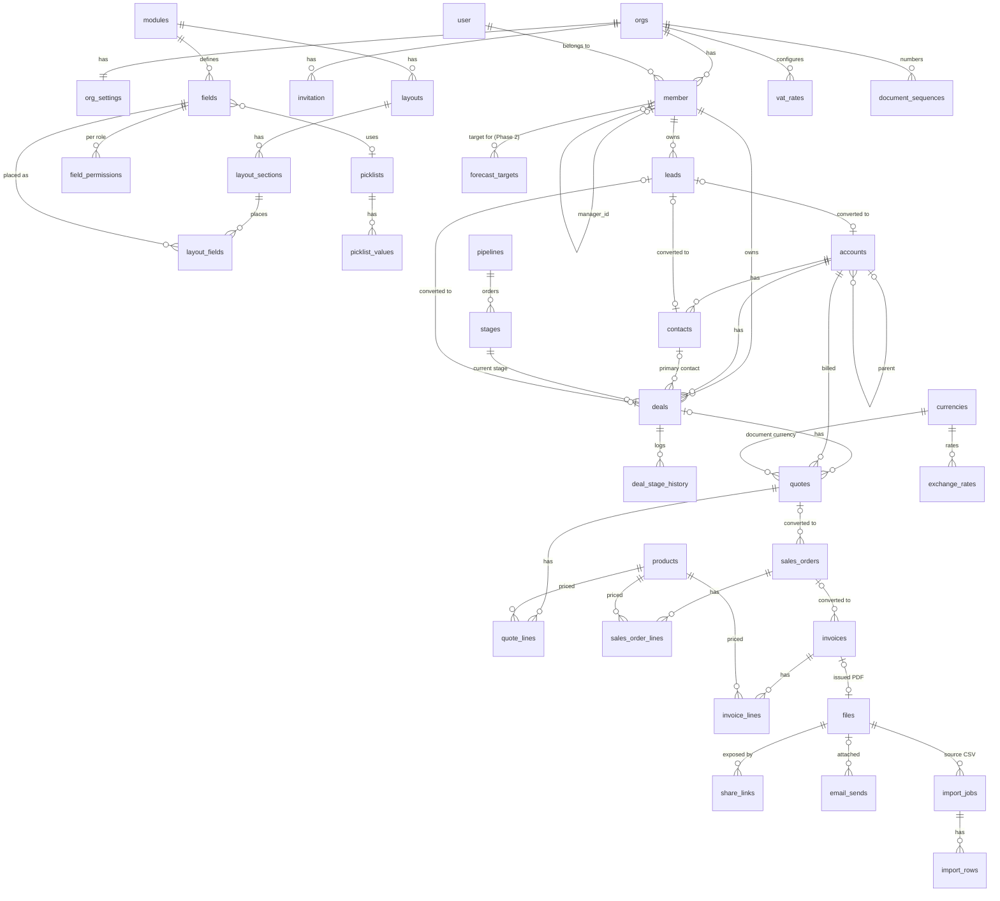

# Schema

Status: **Design** (2026-10-27). The target for slices 1–9 and 11. Slice 10 (Forecasts) moved to Phase 2 on 2026-10-27: its parts are kept below and marked **Phase 2**, and are not built in the MVP. What is already migrated is listed in the migrations log at the end.
Design: `docs/TRD.md` · Decisions: `docs/adr/` (tenancy [0003](adr/0003-tenancy-org-id-row-level-security.md), visibility [0005](adr/0005-rbac-and-record-visibility.md), metadata [0006](adr/0006-metadata-driven-fields-and-layouts.md), money [0007](adr/0007-money-vat-currency.md), numbering [0008](adr/0008-gap-free-invoice-numbering-and-locking.md), share links [0009](adr/0009-pdf-share-tokens.md))

PostgreSQL 16. Required extensions: `pg_trgm` (name search), `citext` (emails).

## Conventions (apply to every table unless stated)

| Item | Rule |
|---|---|
| Primary key | `id uuid PRIMARY KEY`, UUID v7, generated in the app |
| Tenant column | `org_id uuid NOT NULL REFERENCES orgs(id) ON DELETE RESTRICT`, plus `UNIQUE (org_id, id)` so children can reference it with a composite key |
| Intra-tenant FKs | **Always composite**: `(org_id, account_id) REFERENCES accounts(org_id, id)`. The DB itself makes it impossible to point at another org's row. For optional lookups, `ON DELETE SET NULL (account_id)` (PG15+ column list) leaves `org_id` intact |
| FK delete rule | `RESTRICT` by default. Records are soft-deleted, so hard deletes are rare and must be explicit. `CASCADE` only for owned children (lines of a draft document, layout parts, import rows) |
| Audit columns (`AUDIT`) | `created_at timestamptz NOT NULL DEFAULT now()`, `created_by uuid NOT NULL`, `updated_at timestamptz NOT NULL DEFAULT now()`, `updated_by uuid NOT NULL`, `version int NOT NULL DEFAULT 1` (optimistic locking: `PUT` must send the current version, else 409). `created_by`/`updated_by` are composite FKs to `member(org_id, user_id)` |
| Soft delete (`SOFT`) | `deleted_at timestamptz NULL`, `deleted_by uuid NULL`. Default views filter `deleted_at IS NULL`. Unique and hot indexes are **partial** `WHERE deleted_at IS NULL` |
| Record columns (`REC`) | `AUDIT` + `SOFT` + `owner_id uuid NOT NULL` (composite FK → `member(org_id, user_id)`, RESTRICT) + `custom jsonb NOT NULL DEFAULT '{}'` (ADR-0006) |
| Importable (`ZOHO`) | `zoho_id text NULL`, `needs_review boolean NOT NULL DEFAULT false` (set when the import falls back to the importing Admin as owner), `UNIQUE (org_id, zoho_id) WHERE zoho_id IS NOT NULL` |
| Money | Amounts `numeric(18,3)`; FX rates `numeric(18,8)`; percentages `numeric(7,4)`; quantities `numeric(14,3)`. Never `real`/`double`. Drizzle `mode: 'string'` |
| Currency on a row | `currency char(3)` (composite FK → `currencies(org_id, code)`), `currency_scale smallint CHECK (currency_scale IN (2,3))`, `exchange_rate numeric(18,8) CHECK (> 0)` = OMR per 1 unit (1 for OMR) |
| Enums | Postgres enums for closed system sets (statuses, VAT category). Picklists that admins can edit are `text`, validated in the service against `picklist_values` |
| Text limits | `varchar(n)` where the reference spec sets a limit; `text` with `CHECK (char_length(x) <= 32000)` for descriptions |
| Phones | `mobile` stored as E.164: `CHECK (mobile ~ '^\+[1-9][0-9]{6,14}$')`. Normalised server-side from the country (US-06) |
| Countries | `char(2)` ISO 3166-1 alpha-2; display names come from i18n |
| Indexes | Every index leads with `org_id`. List pages use `(org_id, owner_id, updated_at DESC) WHERE deleted_at IS NULL`. Name search uses a GIN `gin_trgm_ops` index on the name expression |
| Timestamps | `timestamptz`; business dates (closing date, due date, invoice date) are `date` and are interpreted in `Asia/Muscat` |

### Row Level Security (every table with `org_id`)

| Policy | Applies to | Predicate |
|---|---|---|
| `tenant_isolation` (permissive, `TO crm_app`) | all tables with `org_id` (and `orgs`, on `id`, SELECT only) | `org_id = app.org_id()`, with the same predicate as `WITH CHECK` |
| `owner_visibility` (**restrictive**) | `leads`, `deals`, `quotes`, `sales_orders`, `invoices`, `activities` | `current_setting('app.see_all', true) = 'on' OR owner_id = ANY (app.visible_owner_ids())` |
| `parent_visibility` (**restrictive**) | `quote_lines`, `sales_order_lines`, `invoice_lines` | `EXISTS (SELECT 1 FROM <parent> p WHERE p.id = <parent_id>)`. The subquery is itself RLS-filtered |
| `record_visibility` (**restrictive**) | `notes`, `files`, `share_links`, `email_sends`, `timeline_events` | `app.can_see(record_type, record_id)`. This is a `STABLE SECURITY INVOKER` function doing an `EXISTS` on the right table, so that table's RLS applies |
| `target_visibility` (**restrictive**), **Phase 2** | `forecast_targets` | `see_all OR user_id = ANY (app.visible_owner_ids())` |
| `admin_only` (**restrictive**) | `import_jobs`, `import_rows`, `org_settings` (write), metadata tables (write) | `current_setting('app.role', true) = 'admin'` |

`app.org_id()` is `NULLIF(current_setting('app.org_id', true), '')::uuid`: a pooled connection reads a finished transaction's setting back as `''`, which must match nothing rather than raise (ADR-0003 amendment). `app.visible_owner_ids()` parses `current_setting('app.visible_owner_ids', true)` into `uuid[]` the same way (NULL when unset). Both live in schema `app` (USAGE for `crm_app` only). All tables use `ENABLE` + `FORCE ROW LEVEL SECURITY`. A CI test fails if any table with an `org_id` column is missing RLS, FORCE or `tenant_isolation`.

### Grants

- **`crm_owner`.** Owns all objects and runs migrations. The app never connects as it.
- **`crm_app`:**
  - `SELECT, INSERT, UPDATE` on all tenant tables.
  - **No `DELETE`**, except on `*_lines`, `layout_*`, `idempotency_keys` and `import_rows` (guard triggers apply).
  - **Insert-only** (`SELECT, INSERT`) on the append-only tables `timeline_events`, `deal_stage_history`, `exchange_rates`, `vat_rates`.
  - `EXECUTE` on `resolve_share_link()`.
- **`crm_auth`.** Only Better Auth's tables (`user`, `session`, `account`, `verification`, `orgs`, `member`, `invitation`). It has no grant on any CRM table. Because of FORCE RLS, `orgs`, `member` and `invitation` carry an extra permissive policy `auth_access TO crm_auth USING (true)`; otherwise Better Auth would see zero rows.

The per-transaction settings are `app.org_id`, `app.user_id`, `app.role`, `app.visible_owner_ids` and `app.see_all` (ADR-0003).

## ERD

Abbreviated: only keys and relationship columns are shown. Full columns are in the tables below.

Polymorphic links have no FKs: activities `who`/`what`, notes, files, share links, email sends and timeline events point at records through `(record_type, record_id)`. A trigger (`check_record_ref`) verifies on insert that the target exists in the same org.

## Tables

### Tenancy and auth

Better Auth tables (ADR-0004) use Better Auth's schema, with model and field names mapped: `organization → orgs`, `organizationId → org_id`. IDs are generated as UUID v7 through Better Auth's id generator. Their columns are owned by Better Auth's CLI migrations and are listed here for reference; check them again when Better Auth is upgraded.

#### `orgs` (Better Auth `organization`)
| Column | Type | Constraints |
|---|---|---|
| id | uuid | PK |
| name | text | NOT NULL |
| slug | text | NOT NULL, UNIQUE |
| logo | text | NULL |
| metadata | text | NULL |
| created_at | timestamptz | NOT NULL |

RLS for `crm_app`: `id = app.org_id` (read only). There is no soft delete: a tenant is offboarded by a runbook, never by the app.

#### `org_settings`
| Column | Type | Constraints |
|---|---|---|
| org_id | uuid | PK, FK → orgs RESTRICT |
| legal_name | varchar(200) | NOT NULL |
| address_line1, address_line2, city, postal_code | varchar(250)/varchar(30) | |
| country | char(2) | NOT NULL DEFAULT 'OM' |
| vat_number | varchar(20) | NULL (seller VATIN on tax invoices) |
| base_currency | char(3) | NOT NULL DEFAULT 'OMR', CHECK = 'OMR' (MVP) |
| fiscal_year_start_month | smallint | NOT NULL DEFAULT 1, CHECK 1–12. Read only by forecasts (Phase 2) |
| share_link_ttl_days | smallint | NOT NULL DEFAULT 7, CHECK 1–30 |
| smtp_host, smtp_username, smtp_from_email, smtp_from_name | text | NULL |
| smtp_port | int | NULL, CHECK 1–65535 |
| smtp_secret_ref | text | NULL. Secrets Manager ARN; the password itself is never stored in the DB |
| updated_at, updated_by, version | | AUDIT subset |

#### `user` (Better Auth, global, no `org_id`)
| Column | Type | Constraints |
|---|---|---|
| id | uuid | PK |
| name | text | NOT NULL |
| email | citext | NOT NULL, UNIQUE |
| email_verified | boolean | NOT NULL DEFAULT false |
| image | text | NULL |
| role | text | NULL. Admin plugin's global role. CRM roles live on `member.role`; nobody is given a global role |
| banned | boolean | NULL. Admin plugin; `true` = deactivated (US-01/US-03) |
| ban_reason | text | NULL |
| ban_expires | timestamptz | NULL |
| created_at, updated_at | timestamptz | NOT NULL |

`crm_app` reads users through the view `org_users` (`security_invoker`), which joins `user` with `member` and exposes `id, name, email, role, manager_id, status, created_at`. `user` has RLS + FORCE: `crm_auth` gets `auth_access`, and `crm_app` gets `SELECT (id, name, email)` under policy `org_member` (the user is a member visible under `member`'s RLS, so only the current org's members).

#### `session`, `account`, `verification` (Better Auth, global)
- **`session`:** `id`, `user_id` (FK → user CASCADE), `token` (UNIQUE), `expires_at`, `ip_address`, `user_agent`, `active_organization_id` (uuid), `impersonated_by` (uuid, admin plugin), `created_at`, `updated_at`.
- **`account`:** `id`, `user_id` (FK CASCADE), `account_id`, `provider_id`, `password` (Better Auth hash), token columns (unused for credentials), `created_at`, `updated_at`.
- **`verification`:** `id`, `identifier`, `value`, `expires_at`, `created_at`, `updated_at`.

No Better Auth table has a DB default for `id`: the app supplies UUID v7 (Better Auth `generateId`, T1.09).

`crm_app` has no grants on any of these three tables.

#### `member` (Better Auth, extended)
| Column | Type | Constraints |
|---|---|---|
| id | uuid | PK |
| org_id | uuid | NOT NULL FK → orgs RESTRICT |
| user_id | uuid | NOT NULL FK → user RESTRICT |
| role | text | NOT NULL CHECK IN ('admin','manager','rep') |
| manager_id | uuid | NULL, composite FK `(org_id, manager_id) → member(org_id, user_id)` ON DELETE SET NULL (manager_id); CHECK `manager_id <> user_id` |
| status | text | NOT NULL DEFAULT 'active' CHECK IN ('active','deactivated') |
| created_at | timestamptz | NOT NULL |

- **Keys:** UNIQUE `(org_id, user_id)` (target of the owner FKs).
- **Index:** `(org_id, manager_id)`.
- **Trigger:** `member_no_cycle` rejects a `manager_id` that would create a cycle (recursive check).

#### `invitation` (Better Auth)
`id`, `org_id` (FK), `email` (citext), `role` (CHECK as in `member`), `status` (pending/accepted/rejected/canceled), `expires_at`, `inviter_id` (FK → user), `created_at`, plus our `name` (text) and `manager_id` (composite FK → `member(org_id, user_id)` ON DELETE SET NULL (manager_id)), applied to the membership on accept. `token_hash` (text, UNIQUE): SHA-256 hex of the random 256-bit accept token, set NULL once accepted. Index `(org_id, email)`. `crm_app` may INSERT (restrictive `admin_only_insert`).

### Metadata (ADR-0006)

All metadata tables carry `org_id` and `AUDIT`. System rows are seeded for each org.

#### `modules`
| Column | Type | Constraints |
|---|---|---|
| id, org_id | uuid | |
| api_name | varchar(60) | NOT NULL, UNIQUE (org_id, api_name). Immutable (trigger) |
| label_key | varchar(120) | NOT NULL (i18n key) |
| is_custom | boolean | NOT NULL DEFAULT false (always false in the MVP) |
| sort_order | smallint | NOT NULL |

#### `fields`
| Column | Type | Constraints |
|---|---|---|
| id, org_id | uuid | |
| module_id | uuid | NOT NULL, composite FK → modules CASCADE |
| api_name | varchar(60) | NOT NULL, UNIQUE (org_id, module_id, api_name). **Immutable** (trigger `fields_api_name_immutable`) |
| label_key | varchar(120) | NOT NULL |
| data_type | enum `field_type` | text, textarea, email, phone, url, picklist, multiselect, date, datetime, integer, decimal, currency, percent, boolean, lookup, user_lookup, polymorphic, autonumber |
| is_system | boolean | NOT NULL |
| column_name | varchar(63) | NULL. CHECK `is_system = (column_name IS NOT NULL)`; custom fields live in `custom->>api_name` |
| required, is_unique, read_only | boolean | NOT NULL DEFAULT false |
| max_length | int | NULL |
| precision, scale | smallint | NULL |
| default_value | jsonb | NULL |
| picklist_id | uuid | NULL, composite FK → picklists RESTRICT |
| lookup_module_id | uuid | NULL, composite FK → modules RESTRICT |

CHECK: `data_type IN ('picklist','multiselect') = (picklist_id IS NOT NULL)`.

#### `picklists` / `picklist_values`
- **`picklists`:**
  - Columns: `id`, `org_id`, `api_name varchar(60)`.
  - Keys: UNIQUE `(org_id, api_name)`.
- **`picklist_values`:**
  - Columns: `id`, `org_id`, `picklist_id` (composite FK CASCADE), `value varchar(120) NOT NULL` (stored value, stable), `label_key`, `category text NULL CHECK IN ('open','won','lost')`, `sort_order smallint`, `is_active boolean DEFAULT true`.
  - Keys: UNIQUE `(org_id, picklist_id, value)`.
  - Values are deactivated, never deleted, so old records stay valid.

#### `layouts`, `layout_sections`, `layout_fields`
- **`layouts`:**
  - Columns: `id`, `org_id`, `module_id` (FK CASCADE), `name`, `is_default boolean`.
  - Keys: UNIQUE `(org_id, module_id) WHERE is_default`.
- **`layout_sections`:**
  - Columns: `id`, `org_id`, `layout_id` (FK CASCADE), `label_key`, `sort_order`, `columns smallint CHECK IN (1,2)`.
- **`layout_fields`:**
  - Columns: `id`, `org_id`, `section_id` (FK CASCADE), `field_id` (FK CASCADE), `sort_order`.
  - Keys: UNIQUE `(org_id, section_id, field_id)`.

#### `field_permissions`
| Column | Type | Constraints |
|---|---|---|
| org_id, field_id | uuid | PK (org_id, field_id, role); field FK CASCADE |
| role | text | CHECK IN ('admin','manager','rep') |
| access | text | NOT NULL CHECK IN ('read_write','read_only','hidden') |

A missing row means `read_write`.

### CRM records

#### `leads` (REC, ZOHO), private
| Column | Type | Constraints |
|---|---|---|
| salutation | varchar(20) | picklist |
| first_name | varchar(40) | |
| last_name | varchar(80) | **NOT NULL** (US-04) |
| company | varchar(100) | **NOT NULL** (US-04) |
| designation | varchar(100) | |
| email, secondary_email | citext | CHECK length ≤ 100 |
| phone, fax | varchar(30) | |
| mobile | varchar(16) | E.164 CHECK |
| website | varchar(120) | |
| lead_source, lead_status, industry, rating | varchar(60) | picklists |
| annual_revenue | numeric(18,3) | OMR |
| no_of_employees | int | CHECK ≥ 0 |
| email_opt_out | boolean | NOT NULL DEFAULT false |
| street | varchar(250) | |
| city, state, zip_code | varchar(30) | |
| country | char(2) | |
| description | text | CHECK ≤ 32000 |
| is_converted | boolean | NOT NULL DEFAULT false |
| converted_at | timestamptz | CHECK `is_converted = (converted_at IS NOT NULL)` |
| converted_by | uuid | composite FK → member |
| converted_account_id / contact_id / deal_id | uuid | composite FKs → accounts/contacts/deals RESTRICT |

- **Indexes:**
  - `(org_id, owner_id, updated_at DESC) WHERE deleted_at IS NULL AND NOT is_converted`
  - `(org_id, lower(email))`
  - GIN trigram on `(company || ' ' || last_name)`
- **Trigger:** `leads_converted_readonly` blocks UPDATEs of a converted lead (US-05).
- `converted_deal_id` → deals (composite FK, RESTRICT; migration 0017).

#### `accounts` (REC, ZOHO), public in org
| Column | Type | Constraints |
|---|---|---|
| account_name | varchar(100) | **NOT NULL** |
| parent_account_id | uuid | composite FK → accounts ON DELETE SET NULL (parent_account_id); CHECK ≠ id |
| account_number | varchar(40) | |
| account_site | varchar(80) | |
| ticker_symbol | varchar(20) | |
| account_type, ownership, industry, rating | varchar(60) | picklists |
| phone, fax | varchar(30) | |
| email | citext | |
| website | varchar(120) | |
| employees, sic_code | int | |
| annual_revenue | numeric(18,3) | |
| vat_number | varchar(20) | customer VATIN (US-06, US-12) |
| billing_street / city / state / code / country | varchar(250)/(30)/(30)/(30)/char(2) | |
| shipping_* | same | |
| description | text | CHECK ≤ 32000 |

Indexes: `(org_id, lower(account_name)) WHERE deleted_at IS NULL` (convert match), GIN trigram on `account_name`, `(org_id, parent_account_id)`.

#### `contacts` (REC, ZOHO), public in org
| Column | Type | Constraints |
|---|---|---|
| account_id | uuid | composite FK → accounts ON DELETE SET NULL (account_id) |
| salutation | varchar(20) | |
| first_name | varchar(40) | |
| last_name | varchar(80) | **NOT NULL** |
| title, department | varchar(100) | |
| email, secondary_email | citext | |
| phone, home_phone, other_phone, fax, asst_phone | varchar(30) | |
| mobile | varchar(16) | E.164 CHECK (US-06, US-14) |
| assistant | varchar(80) | |
| date_of_birth | date | |
| reporting_to_id | uuid | composite FK → contacts SET NULL; CHECK ≠ id |
| lead_source | varchar(60) | |
| email_opt_out | boolean | NOT NULL DEFAULT false |
| mailing_* / other_* | address group | |
| description | text | |
| converted_from_lead_id | uuid | composite FK → leads RESTRICT |

Indexes: `(org_id, lower(email)) WHERE deleted_at IS NULL` (convert match, US-05), `(org_id, account_id)`, GIN trigram on `(first_name || ' ' || last_name)`.

#### `pipelines` / `stages`
- **`pipelines`:**
  - Columns: `id`, `org_id`, `name varchar(80)`, `is_default boolean`, AUDIT.
  - Keys: UNIQUE `(org_id, name)` and `(org_id) WHERE is_default`.
  - The MVP seeds exactly one pipeline.
- **`stages`:**

  | Column | Type | Constraints |
  |---|---|---|
  | id, org_id | uuid | |
  | pipeline_id | uuid | composite FK → pipelines RESTRICT |
  | name_key | varchar(120) | i18n key |
  | api_value | varchar(60) | UNIQUE (org_id, pipeline_id, api_value) |
  | sort_order | smallint | |
  | probability | smallint | CHECK 0–100 |
  | record_category | enum `stage_category` | open, closed_won, closed_lost |
  | forecast_category | enum `forecast_category` | pipeline, best_case, committed, closed, omitted |
  | is_active | boolean | |

  Seeded from reference §2.7.

#### `deals` (REC, ZOHO), private
| Column | Type | Constraints |
|---|---|---|
| deal_name | varchar(120) | **NOT NULL** |
| account_id | uuid | **NOT NULL**, composite FK → accounts RESTRICT |
| contact_id | uuid | composite FK → contacts SET NULL (contact_id) |
| contact_role | varchar(60) | |
| type, lead_source | varchar(60) | |
| amount | numeric(18,3) | CHECK ≥ 0 |
| currency, currency_scale, exchange_rate | | see conventions; captured on create (US-09) |
| amount_omr | numeric(18,3) | GENERATED ALWAYS AS `round(amount * exchange_rate, 3)` STORED (Kanban Σ; forecasts use it in Phase 2) |
| closing_date | date | **NOT NULL** |
| pipeline_id | uuid | NOT NULL, composite FK RESTRICT |
| stage_id | uuid | NOT NULL, composite FK → stages RESTRICT |
| probability | smallint | NOT NULL CHECK 0–100 |
| expected_revenue | numeric(18,3) | GENERATED `round(amount * probability / 100, currency_scale)` STORED |
| forecast_category | enum `forecast_category` | NOT NULL |
| next_step | varchar(100) | |
| reason_for_loss | varchar(120) | required when the stage is closed_lost (enforced by service and trigger `deals_stage_rules`) |
| closed_at | timestamptz | set when record_category ≠ open |
| description | text | |
| converted_from_lead_id | uuid | composite FK → leads |

Postgres `round(numeric, int)` rounds half away from zero, which is half-up for the non-negative values allowed here. That makes it consistent with the pricing engine.

- **Indexes:**
  - `(org_id, owner_id, closing_date) WHERE deleted_at IS NULL` (forecast; **Phase 2**, created with slice 10)
  - `(org_id, pipeline_id, stage_id) WHERE deleted_at IS NULL` (Kanban)
  - `(org_id, account_id)`
  - GIN trigram on `deal_name`
- **Trigger:** `deals_stage_rules`, on a stage change:
  - sets the default probability and forecast category,
  - enforces the Closed Won/Lost rules (US-07),
  - inserts a row into `deal_stage_history`.

#### `deal_stage_history`, append-only
`id`, `org_id`, `deal_id` (composite FK RESTRICT), `stage_id`, `amount numeric(18,3)`, `probability smallint`, `forecast_category`, `closing_date date`, `changed_at timestamptz NOT NULL`, `changed_by uuid`, `seconds_in_previous_stage bigint`. Index `(org_id, deal_id, changed_at)`. Visibility follows the deal (restrictive `parent_visibility`).

#### `activities` (REC), private
| Column | Type | Constraints |
|---|---|---|
| type | enum `activity_type` | task, call, meeting |
| subject | varchar(255) | **NOT NULL** |
| status | varchar(30) | picklist display values. Task: Not Started, Deferred, In Progress, Completed, Waiting for input; call/meeting: Planned, Held, Cancelled. Trigger `activities_completed_at` sets `completed_at` when a task is Completed or a call/meeting is Held or Cancelled, and clears it otherwise |
| priority | varchar(20) | task only: Highest, High, Normal, Low, Lowest |
| due_date | date | task |
| start_at, end_at | timestamptz | meeting: NOT NULL, CHECK end_at ≥ start_at |
| all_day | boolean | meeting |
| venue | varchar(255) | meeting |
| call_type | varchar(10) | CHECK IN ('Inbound', 'Outbound', 'Missed'); call: NOT NULL |
| call_purpose, call_result | varchar(120) | |
| call_start_at | timestamptz | call: NOT NULL |
| call_duration_seconds | int | call: NOT NULL CHECK ≥ 0 |
| who_type | enum `record_type` | CHECK IN (lead, contact) |
| who_id | uuid | CHECK `(who_type IS NULL) = (who_id IS NULL)` |
| what_type | enum `record_type` | CHECK IN (account, deal, quote, sales_order, invoice) |
| what_id | uuid | CHECK `(what_type IS NULL) = (what_id IS NULL)` |
| completed_at | timestamptz | server-set (see status); never client-writable |
| description | text | |

- **Type-specific checks:** CHECK constraints enforce the columns each `type` requires (`activities_meeting_times`, `activities_call_fields`, `activities_call_duration`).
- **Links:** trigger `check_record_ref` on `who`/`what` rejects a target the writer cannot see (another org's, missing, or one hidden by RLS), as a foreign-key violation on `activities_who_id_fk` / `activities_what_id_fk`. `app.can_see()` knows `account`, `contact` and `activity`; each later slice adds its own types (so `who_type = 'lead'` and the document types fail closed until then).
- **Indexes:**
  - `(org_id, owner_id, due_date) WHERE completed_at IS NULL AND deleted_at IS NULL` (My Activities / overdue, US-15)
  - `(org_id, who_type, who_id)`
  - `(org_id, what_type, what_id)`

System activities such as "Email sent to X" and "WhatsApp link shared" are `type = 'task'` rows with `status = 'completed'` and `meta` in `timeline_events`. They are never shown as open work.

#### `notes` (AUDIT, SOFT)
`id`, `org_id`, `record_type` (enum `record_type`), `record_id`, `body text NOT NULL CHECK ≤ 32000`, AUDIT, SOFT. Index `(org_id, record_type, record_id, created_at DESC)`. On lead conversion, notes are re-parented to the contact (US-05). Visibility is restrictive: `record_visibility`. A trigger (`check_record_ref`) rejects a note on a record the writer cannot see. There is no `deleted_by` FK yet: the MVP has no note delete.

### Products, currency, VAT

#### `products` (AUDIT, SOFT, ZOHO, custom), public in org
| Column | Type | Constraints |
|---|---|---|
| product_name | varchar(120) | **NOT NULL** |
| product_code | varchar(40) | UNIQUE (org_id, lower(product_code)) WHERE deleted_at IS NULL |
| is_active | boolean | NOT NULL DEFAULT true |
| category | varchar(60) | |
| vat_category | enum `vat_category` | **NOT NULL**: standard, zero_rated, exempt (US-08) |
| unit_price | numeric(18,3) | NOT NULL CHECK ≥ 0, in OMR |
| usage_unit | varchar(30) | |
| description | text | |
| custom | jsonb | |

#### `currencies`
`org_id`, `code char(3)`, `scale smallint CHECK IN (2,3)`, `is_base boolean`, `is_active boolean`. PK `(org_id, code)`. UNIQUE `(org_id) WHERE is_base`. Seeded with OMR (3, base), AED (2) and INR (2).

#### `exchange_rates`, append-only
| Column | Type | Constraints |
|---|---|---|
| id, org_id | uuid | |
| currency | char(3) | composite FK → currencies RESTRICT; CHECK ≠ 'OMR' |
| rate | numeric(18,8) | NOT NULL CHECK > 0. OMR per 1 unit (e.g. AED 0.10500000) |
| effective_from | date | NOT NULL |
| created_at, created_by | | |

- **Keys:** UNIQUE `(org_id, currency, effective_from)`.
- **Lookup:** the latest row with `effective_from ≤ today (Asia/Muscat)`. If no row matches, the create is blocked (US-09).

#### `vat_rates`, append-only
`id`, `org_id`, `category vat_category CHECK IN ('standard','zero_rated')`, `rate numeric(7,4) CHECK 0–100`, `effective_from date`, `created_at`, `created_by`. UNIQUE `(org_id, category, effective_from)`. Seeded with standard = 5.0000 and zero_rated = 0.0000. Exempt lines carry no rate (`vat_rate` NULL on the line).

### Sales documents (ADR-0007, ADR-0008)

**Shared header columns (`DOC`, on `quotes`, `sales_orders`, `invoices`).** REC plus:

| Column | Type | Constraints |
|---|---|---|
| subject | varchar(255) | **NOT NULL** |
| account_id | uuid | **NOT NULL**, composite FK → accounts RESTRICT |
| contact_id | uuid | composite FK → contacts SET NULL (contact_id) |
| deal_id | uuid | composite FK → deals SET NULL (deal_id) |
| billing_* / shipping_* | address groups | copied from account on create |
| terms, description | text | |
| currency, currency_scale, exchange_rate | | snapshot (US-09, US-11) |
| sub_total | numeric(18,3) | NOT NULL; Σ line net_amount (**server-computed**) |
| vat_total | numeric(18,3) | NOT NULL; Σ line vat_amount |
| adjustment | numeric(18,3) | NOT NULL DEFAULT 0 (no VAT, OQ-04) |
| grand_total | numeric(18,3) | NOT NULL = sub_total + vat_total + adjustment (CHECK) |
| vat_total_omr, grand_total_omr | numeric(18,3) | NOT NULL; `round(x * exchange_rate, 3)` |

CHECK `scale_ok`: `round(sub_total, currency_scale) = sub_total`, and the same for `vat_total`, `adjustment` and `grand_total`. The VAT summary per category is derived with `GROUP BY vat_category` over the lines, so it is never stored twice.

#### `quotes` (DOC, ZOHO)
`quote_number varchar(30) NOT NULL` (UNIQUE `(org_id, quote_number)`, taken from `document_sequences` on create), `quote_stage enum` (draft, negotiation, delivered, on_hold, confirmed, closed_won, closed_lost), `valid_till date`. Indexes: `(org_id, owner_id, updated_at DESC) WHERE deleted_at IS NULL`, `(org_id, deal_id)`, `(org_id, account_id)`.

#### `sales_orders` (DOC)
`so_number varchar(30) NOT NULL` UNIQUE `(org_id, so_number)`, `quote_id` (composite FK → quotes RESTRICT), `customer_no varchar(40)`, `purchase_order_ref varchar(60)`, `due_date date`, `status enum` (created, approved, delivered, cancelled). Index `(org_id, quote_id)`.

#### `invoices` (DOC)
| Column | Type | Constraints |
|---|---|---|
| invoice_number | varchar(30) | NULL while draft; UNIQUE (org_id, invoice_number); CHECK `status = 'draft' OR invoice_number IS NOT NULL` |
| sales_order_id | uuid | composite FK → sales_orders RESTRICT |
| invoice_date | date | set on issue |
| due_date | date | |
| customer_no, purchase_order_ref | varchar | |
| status | enum `invoice_status` | draft, issued, paid, cancelled |
| issued_at, issued_by | | set on issue |
| seller_snapshot | jsonb | set on issue: legal name, address, VATIN (US-12) |
| buyer_snapshot | jsonb | set on issue: name, address, VATIN if any |
| paid_at | timestamptz | |
| cancelled_at, cancelled_by, cancel_reason | | |
| pdf_file_id | uuid | composite FK → files RESTRICT; the issued PDF |

- **Triggers (ADR-0008):**
  - `invoices_lock`: once status ≠ draft, only status, payment and cancel columns may change. Allowed transitions: issued → paid or cancelled; paid → cancelled (Admin only).
  - `invoices_no_delete`: a non-draft invoice cannot be deleted, hard or soft.

#### `quote_lines`, `sales_order_lines`, `invoice_lines`
All three tables have the same shape, with different parent columns: `quote_id` / `sales_order_id` / `invoice_id`.

| Column | Type | Constraints |
|---|---|---|
| id, org_id | uuid | |
| <parent>_id | uuid | NOT NULL, composite FK → parent ON DELETE CASCADE (only drafts can be hard-deleted) |
| line_no | smallint | NOT NULL; UNIQUE (org_id, <parent>_id, line_no) |
| product_id | uuid | **NOT NULL**, composite FK → products RESTRICT (US-10) |
| description | text | defaults from product |
| quantity | numeric(14,3) | NOT NULL **CHECK > 0** (US-10) |
| list_price | numeric(18,3) | NOT NULL CHECK ≥ 0 |
| discount_type | enum | percent, amount; NULL = none |
| discount_value | numeric(18,4) | CHECK ≥ 0; percent ≤ 100 |
| amount | numeric(18,3) | qty × list_price (rounded) |
| discount_amount | numeric(18,3) | |
| net_amount | numeric(18,3) | CHECK = amount − discount_amount |
| vat_category | vat_category | NOT NULL (snapshot) |
| vat_rate | numeric(7,4) | snapshot; NULL iff exempt |
| vat_amount | numeric(18,3) | CHECK `vat_category = 'standard' OR vat_amount = 0` |
| line_total | numeric(18,3) | CHECK = net_amount + vat_amount |

All money columns are written only by the pricing engine. Lock triggers block changes to `invoice_lines` once the invoice is not a draft.

#### `document_sequences`
| Column | Type | Constraints |
|---|---|---|
| org_id | uuid | PK part |
| doc_type | enum | quote, sales_order, invoice; PK (org_id, doc_type) |
| prefix | varchar(20) | NOT NULL DEFAULT '' (OQ-06) |
| padding | smallint | NOT NULL DEFAULT 6 |
| next_value | bigint | NOT NULL CHECK ≥ 1 |

Trigger `sequence_monotonic`: `NEW.next_value ≥ OLD.next_value`.

### Forecasts (Phase 2)

**Phase 2: not built in the MVP** (scope change 2026-10-27, PRD changelog). Kept here as the design for slice 10. No MVP migration creates this table.

#### `forecast_targets` (AUDIT), Phase 2
`id`, `org_id`, `user_id` (composite FK → member), `year smallint CHECK 2000–2100`, `quarter smallint CHECK 1–4`, `target_omr numeric(18,3) NOT NULL CHECK ≥ 0`. UNIQUE `(org_id, user_id, year, quarter)`. Achieved, Committed, Best Case, Pipeline and Gap are **computed** from `deals.amount_omr` per request (US-16) and never stored. The fiscal year starts in January (`org_settings`).

### Files, sending, share links

#### `files`
| Column | Type | Constraints |
|---|---|---|
| id, org_id | uuid | |
| kind | enum `file_kind` | quote_pdf, sales_order_pdf, invoice_pdf, import_csv, import_errors_csv |
| record_type, record_id | | polymorphic owner record |
| status | enum | pending, ready, failed (PDF render) |
| storage_key | text | UNIQUE; `org/<org_id>/<kind>/<id>` |
| filename | varchar(200) | |
| content_type | varchar(100) | |
| size_bytes | bigint | |
| sha256 | bytea | set when ready |
| created_at, created_by | | |

The file is immutable once `ready` (trigger). Index: `(org_id, record_type, record_id, created_at DESC)`.

#### `share_links` (ADR-0009)
| Column | Type | Constraints |
|---|---|---|
| id, org_id | uuid | |
| file_id | uuid | NOT NULL, composite FK → files RESTRICT |
| record_type, record_id | | the record whose timeline logs it |
| token_hash | bytea | NOT NULL **UNIQUE** (global, for lookup without an org); sha256 of the token |
| expires_at | timestamptz | NOT NULL; CHECK `expires_at <= created_at + interval '30 days'` |
| revoked_at, revoked_by | | |
| last_accessed_at | timestamptz | |
| access_count | int | NOT NULL DEFAULT 0 |
| created_at, created_by | | |

The plaintext token is never stored. `resolve_share_link(bytea)` is `SECURITY DEFINER`, with `search_path` pinned, and is the only cross-org reader. It returns `(share_link_id, storage_key, filename, content_type)`: the link id (not the org id, which ADR-0009 listed) so the access log can name the link without the token.

#### `email_sends`
`id`, `org_id`, `record_type`, `record_id`, `file_id` (FK), `to_contact_id` (FK → contacts), `to_email citext NOT NULL`, `subject varchar(255)`, `body text` (the message, at most 5000), `status enum` (queued, sending, sent, failed), `attempts smallint`, `error_code`, `error_message varchar(500)`, `provider_message_id`, `queued_at`, `sent_at`, `created_by`. Index `(org_id, status, queued_at) WHERE status IN ('queued','sending')` (outbox sweeper).

#### `idempotency_keys` (ADR-0015)
`org_id`, `user_id`, `key varchar(255)`, `request_hash bytea NOT NULL`, `status enum` (in_progress, completed), `response_status smallint`, `response_body jsonb`, `created_at`, `expires_at` (= created_at + 7 days). PK `(org_id, user_id, key)`. A daily job purges expired rows.

### Audit / timeline

#### `timeline_events`, append-only
| Column | Type | Constraints |
|---|---|---|
| id, org_id | uuid | |
| record_type | enum `record_type` | lead, account, contact, deal, quote, sales_order, invoice, activity, product, user, org |
| record_id | uuid | NOT NULL |
| event_type | varchar(40) | created, updated, deleted, restored, stage_changed, converted, owner_transferred, email_sent, email_failed, whatsapp_shared, share_link_revoked, invoice_issued, invoice_paid, invoice_cancelled, note_added, activity_completed, imported, role_changed, user_deactivated |
| actor_id | uuid | NULL for system |
| occurred_at | timestamptz | NOT NULL DEFAULT now() |
| changes | jsonb | `{api_name: [old, new]}`; money as strings |
| meta | jsonb | e.g. `{share_link_id}`, never tokens or passwords |

- **Index:** `(org_id, record_type, record_id, occurred_at DESC)`.
- **Grants:** `crm_app` has INSERT and SELECT only.
- **Partitioning:** monthly by `occurred_at`, once the table exceeds about 10M rows. Not needed at MVP volume.

### Zoho import (US-17)

#### `import_jobs` (AUDIT), Admin only
| Column | Type | Constraints |
|---|---|---|
| id, org_id | uuid | |
| module | enum | leads, accounts, contacts, deals, products |
| source_file_id | uuid | composite FK → files RESTRICT |
| mapping | jsonb | NOT NULL; CSV header → field api_name |
| status | enum | uploaded, validating, validated, importing, done, failed, cancelled |
| total_rows, valid_rows, error_rows, imported_rows, duplicate_rows, flagged_rows | int | Recounted from the rows. A row that matches an existing Zoho id is `duplicate` (updated, no new record) even if its owner is unknown |
| failure_message | text | NULL; a failure of the job itself (an unreadable file) |
| errors_file_id | uuid | FK → files; unused: the errors CSV is generated on request from the failed rows, formula-escaped |
| confirmed_at, confirmed_by, finished_at | | nothing is written to CRM tables until `confirmed_at` is set (dry run first) |

#### `import_rows`
`id`, `org_id`, `job_id` (FK CASCADE), `row_no int`, `raw jsonb NOT NULL` (the parsed CSV row), `zoho_id text`, `status enum` (valid, error, imported, duplicate, flagged_owner), `errors jsonb` (`[{column, message}]`), `record_id uuid`. UNIQUE `(org_id, job_id, row_no)`. Rows and the source CSV are purged 90 days after the job finishes, because they contain PII.

Re-importing the same file creates no duplicates. Rows are upserted on `UNIQUE (org_id, zoho_id)`. Lookups resolve Zoho id first, then fall back to name, **within the same org and under the importing Admin's visibility**.

## Relationships

| From → To | Cardinality | FK rule |
|---|---|---|
| member → orgs, user | N:1 | RESTRICT |
| member.manager_id → member | N:1 | SET NULL (manager_id); no cycles |
| contacts → accounts | N:1 optional | SET NULL (account_id) |
| deals → accounts | N:1 required | RESTRICT |
| deals → contacts | N:1 optional | SET NULL (contact_id) |
| deals → pipelines / stages | N:1 required | RESTRICT |
| leads → converted account/contact/deal | 1:1 optional | RESTRICT |
| quotes → deals / accounts / contacts | N:1 | SET NULL / RESTRICT / SET NULL |
| sales_orders → quotes | N:1 optional | RESTRICT |
| invoices → sales_orders | N:1 optional | RESTRICT |
| *_lines → parent document | N:1 | CASCADE (drafts only; triggers block otherwise) |
| *_lines → products | N:1 | RESTRICT |
| exchange_rates → currencies | N:1 | RESTRICT |
| share_links → files | N:1 | RESTRICT |
| invoices.pdf_file_id → files | 1:1 | RESTRICT |
| activities / notes / files / share_links / email_sends / timeline_events → any record | polymorphic | no FK; `check_record_ref` trigger + `record_visibility` RLS |
| import_rows → import_jobs | N:1 | CASCADE |
| every table → orgs | N:1 | RESTRICT |

## Migrations log

| # | Date | Description | Slice |
|---|---|---|---|
| — | 2026-10-27 | `packages/db/bootstrap/01-roles.sh` (not a migration; run once by the superuser): roles `crm_owner`, `crm_app`, `crm_auth` (all NOBYPASSRLS), databases `crm` and `crm_test` owned by `crm_owner`, `CONNECT` for the app roles only | 1 |
| 0000 | 2026-10-27 | `extensions_grants`: `pg_trgm`, `citext`; `USAGE` on `public` for `crm_app`/`crm_auth`, no `CREATE` for anyone but the owner | 1 |
| 0001 | 2026-10-27 | `auth`: Better Auth tables `user`, `session`, `account`, `verification`, `orgs`, `member` (+`manager_id`, `status`), `invitation` (generated by drizzle-kit from `src/schema/auth.ts`) | 1 |
| 0002 | 2026-10-27 | `auth_grants_rls`: composite `member_manager_fk`; `crm_auth` DML on the auth tables only; `crm_app` SELECT on `orgs`/`member`/`invitation`; RLS + FORCE on those three with an `auth_access` policy for `crm_auth` (`crm_app` sees zero rows until `tenant_isolation`, T1.05) | 1 |
| 0003 | 2026-10-27 | `rls_helpers`: schema `app` with `app.org_id()` and `app.visible_owner_ids()`; `tenant_isolation` for `crm_app` on `member`, `invitation` (read and write check) and `orgs` (read only) | 1 |
| 0004 | 2026-10-27 | `member_no_cycle`: trigger on `member` (INSERT, UPDATE OF `manager_id`) that walks up the new manager's chain and rejects a reporting cycle of any length (AC-37); takes a per-org advisory lock so two concurrent edits cannot form a loop together. Self-management stays with the `member_manager_not_self` CHECK | 1 |
| 0005 | 2026-10-27 | `timeline`: enum `record_type`, append-only `timeline_events` (`crm_app` SELECT/INSERT only, AC-25) with RLS + FORCE, `tenant_isolation` and restrictive `record_visibility`; `app.can_see(record_type, uuid)` (SECURITY INVOKER) covers `org` and `user` only, other types are invisible until their slice adds a branch | 1 |
| 0006 | 2026-10-27 | `metadata`: enum `field_type`; `modules`, `fields`, `picklists`, `picklist_values`, `layouts`, `layout_sections`, `layout_fields`, `field_permissions`, each with `org_id` + AUDIT (composite `created_by`/`updated_by` FKs to `member`) and composite intra-tenant FKs; trigger `api_name_immutable` on `modules` and `fields`; `crm_app` SELECT/INSERT/UPDATE (DELETE on `layout_sections`/`layout_fields` only); RLS + FORCE, `tenant_isolation`, restrictive `admin_only_insert`/`_update`/`_delete`. Choices not fixed above: `layouts.name` is varchar(80), `layout_sections.columns` defaults to 2 | 1 |
| 0007 | 2026-10-27 | `metadata_integrity`: CHECK `fields.column_name` is an identifier; trigger `fields_system_immutable` (`is_system`, `column_name`); trigger `app.set_audit_columns()` on every metadata table sets `created_*`/`updated_*` from `app.user_id` (caller values ignored; no user context → error) | 1 |
| 0008 | 2026-10-27 | `org_users`: `invitation.name`, `invitation.manager_id` (+ composite FK); RLS + FORCE on `user` (`auth_access` for `crm_auth`, `org_member` SELECT for `crm_app` on `id, name, email`); view `org_users`; `crm_app` INSERT on `invitation` and UPDATE (`role`, `manager_id`, `status`) on `member`, each with a restrictive admin-only policy (AC-35) | 1 |
| 0009 | 2026-10-27 | `accounts`: REC + ZOHO columns (`packages/db/src/schema/_columns.ts`), composite `accounts_parent_fk` ON DELETE SET NULL (`parent_account_id`), CHECK parent ≠ id, list/name/trigram/parent indexes, partial unique `zoho_id`; `app.set_audit_columns()` trigger; `crm_app` SELECT/INSERT/UPDATE (no DELETE); RLS + FORCE + `tenant_isolation` (public in org); `app.can_see` gains `account`. Choice not fixed above: CHECK `employees >= 0` | 2 |
| 0010 | 2026-10-27 | `idempotency_keys`: enum `idempotency_status`; PK `(org_id, user_id, key)`, composite FK → `member` ON DELETE CASCADE, `expires_at` defaults to `now() + 7 days`; `crm_app` SELECT/INSERT/UPDATE/DELETE; RLS + FORCE + `tenant_isolation` (the service filters by user). Expired keys are replaced on reuse until the purge job lands (slice 8) | 2 |
| 0011 | 2026-10-27 | `contacts`: REC + ZOHO columns, mailing/other address groups, CHECK `mobile ~ '^[+][1-9][0-9]{6,14}$'` (E.164), CHECKs on email length, reporting_to ≠ id and description; hand-written composite `contacts_account_fk` and `contacts_reporting_to_fk` ON DELETE SET NULL (column); list/email/account/trigram (`coalesce(first_name,'') \|\| ' ' \|\| last_name`) indexes, partial unique `zoho_id`; audit trigger; `crm_app` SELECT/INSERT/UPDATE; RLS + FORCE + `tenant_isolation` (public in org); `app.can_see` gains `contact`. `converted_from_lead_id` has no FK until `leads` exists (slice 4) | 2 |
| 0015 | 2026-10-28 | `invitation_token`: `invitation.token_hash` (SHA-256 of the random accept token) with a UNIQUE index | 4 |
| 0016 | 2026-10-28 | `leads`: REC + ZOHO columns, converted_* composite FKs (RESTRICT), `contacts_converted_from_lead_fk`, trigger `leads_converted_readonly` (restrict_violation), RLS `tenant_isolation` + restrictive `owner_visibility`, `app.can_see` knows `lead` | 4 |
| 0017 | 2026-10-28 | `pipelines`, `stages`, `currencies`, `deals`, `deal_stage_history`; enums `stage_category`, `forecast_category`; generated `amount_omr` and `expected_revenue`; composite FKs (deal contact SET NULL (contact_id)); `leads_converted_deal_fk`; triggers `deals_stage_rules` (BEFORE: probability, forecast category, pipeline, closed_at, Closed Lost needs a reason) and `deals_stage_history` (AFTER: history row); RLS `tenant_isolation`, admin-only writes on pipelines/stages/currencies, restrictive `owner_visibility` on deals and `parent_visibility` on the history; `app.can_see` knows `deal`. The history id is `gen_random_uuid()` (written by the trigger, not the app) | 5 |
| 0024 | 2026-10-28 | `sales_orders`, `sales_order_lines`: enum `so_status`; DOC header columns, `quote_id` composite FK (RESTRICT), composite account/contact/deal/currency/product FKs, same CHECKs as quotes (`scale_ok`, grand total, line math), audit trigger, RLS `tenant_isolation` + restrictive `owner_visibility` (orders) and `parent_visibility` (lines); `app.can_see` knows `sales_order`. The line columns are shared with `quote_lines` in `schema/quotes.ts` | 8 |
| 0025 | 2026-10-28 | `invoices`, `invoice_lines`: enum `invoice_status`; DOC header plus invoice columns, CHECK `invoices_number_when_issued`, unique `(org_id, invoice_number)`, composite FKs (sales order, account, contact, deal, currency, issued_by/cancelled_by, product); triggers `invoices_lock` (draft only becomes issued; afterwards only status/payment/cancel/PDF columns move, issued to paid or cancelled, paid to cancelled for Admin), `invoices_no_delete`, `invoice_lines_lock`; `crm_app` also has DELETE (drafts only, enforced by the triggers); RLS as sales_orders; `app.can_see` knows `invoice`. `pdf_file_id` gets its FK with the files table | 8 |
| 0026 | 2026-10-28 | `files`: enums `file_kind`, `file_status`; unique `(org_id, id)` and `storage_key`, CHECKs `files_record_ref` (record_type and record_id both set or both NULL), `files_ready` (sha256 and size_bytes once ready) and `files_key_org` (key starts with `org/<org_id>/`); trigger `files_immutable` (a ready file cannot be updated or deleted); `crm_app` has SELECT, INSERT, UPDATE; RLS `tenant_isolation` plus restrictive `record_visibility` (visible with its record, or to its creator when it has none); FK `invoices.pdf_file_id` → `files` RESTRICT | 8 |
| 0027 | 2026-10-29 | `email_sends`: enum `email_status`; composite FKs to `files` (RESTRICT), `member` and `contacts` (SET NULL on the contact), CHECKs `email_sends_no_line_breaks` (no CR or LF in subject or address, AC-44) and `email_sends_body_length`, outbox index `(org_id, status, queued_at) WHERE status IN ('queued','sending')`; trigger `email_sends_check_record_ref` (also added to `files`); `crm_app` has SELECT, INSERT, UPDATE; RLS `tenant_isolation` plus restrictive `record_visibility` | 9 |
| 0028 | 2026-10-29 | `share_links`: unique `token_hash` (sha256, 32 bytes), CHECKs `share_links_ttl` (expires after creation, at most 30 days) and `share_links_token_hash_len`; composite FKs to `files`, `member` (created_by, revoked_by); trigger `share_links_check_record_ref`; `crm_app` has SELECT, INSERT and UPDATE of `revoked_at`, `revoked_by` only; RLS `tenant_isolation` plus restrictive `record_visibility`; policies `resolver` for `crm_owner` on `share_links` (all) and `files` (select); function `public.resolve_share_link(bytea)` `SECURITY DEFINER`, owned by `crm_owner`, `search_path = pg_catalog, public`, returns `(share_link_id, storage_key, filename, content_type)` for a live link and bumps its counters, EXECUTE for `crm_app` only | 9 |
| 0029 | 2026-10-29 | `resolve_share_link` replaced: a link also needs its quote, sales order or invoice to exist (`deleted_at IS NULL`); `crm_owner` read policies `resolver` on `quotes`, `sales_orders`, `invoices` for it. Deleting a document revokes its links (application code) | 9 |
| 0030 | 2026-10-29 | `import_jobs`, `import_rows`: enums `import_module`, `import_status`, `import_row_status`; unique `(org_id, job_id, row_no)`, composite FKs to `files` and `member`, rows cascade from the job; trigger `import_jobs_audit`; `import_rows_delete_guard` (a row can be deleted only 90 days after its job finished); `crm_app` has SELECT, INSERT, UPDATE (and DELETE on rows); RLS `tenant_isolation` plus restrictive `admin_only` | 11 |
