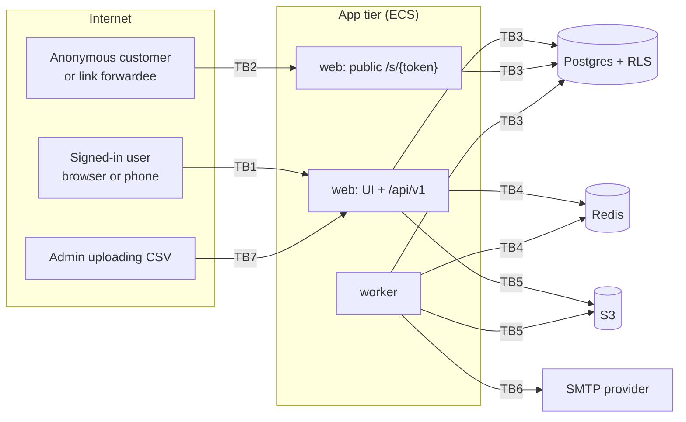

# Threat Model

Status: **Design** (2026-10-27). Review it again at the end of each slice and before go-live.
Inputs: `docs/PRD.md`, `docs/TRD.md`, `docs/SCHEMA.md`, `docs/openapi.yaml`, `docs/adr/`. Method: STRIDE for each trust boundary. Abuse cases are written so they can be turned directly into tests.

## Scope and assumptions

- **In scope:** the MVP (PRD §5): web and API, worker, Postgres, Redis, S3, SMTP egress, the public share-link route, and Zoho CSV import.
- **Out of scope:** AWS account compromise, a compromised developer laptop, the phishing resistance of the SMTP provider, and WhatsApp itself. `wa.me` is a client-side redirect, and we only hand it a URL.
- **Customers are anonymous.** Their only access is through `/s/{token}`.
- **Insiders exist.** A Rep is an authenticated adversary for another Rep's private records, and every user of one org is an adversary for every other org.

## Assets

| Asset | Class | Why it matters |
|---|---|---|
| Customer PII: names, emails, mobiles, addresses, VATINs | PII | Oman PDPL (OQ-03); main breach impact |
| Deal pipeline, amounts, forecasts | Confidential business | Competitive damage; rep-to-rep privacy (US-02) |
| Issued tax invoices and their numbering | Integrity-critical (legal) | Gaps, edits or reuse break VAT compliance (US-12) |
| Money computations (VAT, totals, FX) | Integrity-critical | PRD M3 targets zero corrections |
| Quote/Invoice PDFs and share tokens | PII + confidential | Public link is the only unauthenticated read path |
| Sessions, password hashes | Credential | Account takeover |
| SMTP credentials | Secret | Sending as the org (phishing from our domain) |
| Zoho import files | Bulk PII | One file holds the whole customer base |
| Audit trail (`timeline_events`) | Integrity | Non-repudiation for transfers, issues, cancels |

## Trust boundaries

| ID | Boundary | Untrusted side |
|---|---|---|
| TB1 | Browser → web/API (authenticated) | All request data, including ids, totals, owner fields and `org_id` if anyone sends it |
| TB2 | Internet → public `/s/{token}` | Token, IP, headers. No session |
| TB3 | App → Postgres | App bugs: a missing filter or wrong context. RLS is the second line |
| TB4 | App ↔ Redis (queues, rate limits) | Job payloads are treated as untrusted on dequeue |
| TB5 | App ↔ S3 | Object keys must never derive from user input |
| TB6 | Worker → SMTP | Header injection through record fields; credential misuse |
| TB7 | Admin → CSV import (upload + parse + write) | Whole file content: cells, headers, size, encoding |
| TB8 | Org A ↔ Org B (logical, crosses TB1/TB3) | Every id from another tenant |
| TB9 | Rep ↔ Rep / Manager hierarchy (logical) | Ids of records owned outside the caller's visibility |

## STRIDE per boundary

### TB1: Browser → web/API

| Threat | Example | Mitigation | Abuse case |
|---|---|---|---|
| **S** | Stolen session cookie; CSRF on state-changing POST | httpOnly + Secure + SameSite=Lax cookies; Better Auth origin check; no tokens in localStorage | AC-30, AC-31 |
| **S** | Deactivated user keeps using an old session | Deactivation sets `user.banned` and deletes the user's sessions (ADR-0017); every request re-checks session + member `status` | AC-32 |
| **T** | Client sends its own `Grand_Total`, `VAT_Amount`, `Exchange_Rate`, `Invoice_Number`, `Owner` of someone else, `org_id` | Zod strips unknown and `readOnly` fields; pricing engine is the only writer of money; `org_id` comes only from the session | AC-20, AC-21, AC-22 |
| **T** | Editing an issued invoice or a converted lead | Service state checks + DB lock triggers | AC-23, AC-24 |
| **R** | Rep denies cancelling an invoice or transferring records | `timeline_events` written in the same transaction (append-only grant) | AC-25 |
| **I** | Record existence inferred from 403 vs 404, error text, or timing of search | 404 for invisible records; generic messages; search filtered by the same predicate | AC-10, AC-11 |
| **I** | XSS from record fields (e.g. `Description`) rendered in UI or PDF | React auto-escaping; no `dangerouslySetInnerHTML` without an allowlist sanitizer; CSP `default-src 'self'` | AC-33 |
| **D** | `per_page=100000`, deep `criteria` nesting, huge bodies | `per_page ≤ 200`; criteria depth and length caps; body size limit; rate limit per user | AC-34 |
| **E** | Rep calls Admin endpoints (`/users`, `/imports`, `/settings/*` writes) | Role check in service (403) + `admin_only` RLS policy | AC-35 |
| **E** | `criteria` / `sort_by` / `fields` used for SQL injection | AST parser with field and operator allowlists; parameterized values; `sort_by` checked against field metadata | AC-36 |

### TB2: Public `/s/{token}` (focus area)

| Threat | Example | Mitigation | Abuse case |
|---|---|---|---|
| **S** | Guess or enumerate tokens | 256-bit random token; format check before DB; per-IP rate limit + WAF rule; identical 404 for unknown/expired/revoked | AC-01, AC-02 |
| **S** | Forwarded link used by an unintended third party | Accepted risk (link is bearer by design, US-14); 7-day expiry; revoke from record; access count visible | AC-03 |
| **T** | Swap a file id or record id in the URL or query to reach another PDF | Token resolves to **one** `file_id` inside `resolve_share_link()`; no other parameter is read | AC-04 |
| **T** | Re-rendered quote changes content behind an already-sent link | Link pins an immutable file version; new render needs a new link | AC-05 |
| **R** | Dispute over whether the customer opened it | `access_count`, `last_accessed_at`. Only "shared" is claimed, not "delivered" or "read" | — |
| **I** | Token leaks via logs, APM, `Referer`, browser history sync, proxies, search engines, link previews | Only the hash is stored; `/s/*` redacted in logs and traces; `Referrer-Policy: no-referrer`; `noindex`; `Cache-Control: no-store, private` | AC-06, AC-07 |
| **I** | Expired or revoked link still served from a CDN or browser cache | `no-store`; no CDN caching on `/s/*`; revocation checked on every request | AC-08 |
| **I** | Response leaks `org_id`, record ids, or the S3 bucket hostname | App streams bytes; no redirects to S3; minimal headers | AC-09 |
| **D** | Flood `/s/*` to exhaust DB or S3 | WAF rate rule + Redis limiter; single indexed lookup; streaming with timeouts | AC-02 |
| **E** | `SECURITY DEFINER` function abused (search_path hijack, wider return) | Owned by `crm_owner`; `SET search_path = pg_catalog, public`; takes only `bytea`; returns 4 columns; `EXECUTE` granted only to `crm_app` | AC-40 |

### TB3: App → Postgres (cross-org focus area)

| Threat | Example | Mitigation | Abuse case |
|---|---|---|---|
| **S** | Query runs with another request's tenant context (pooled connection) | `set_config(..., is_local = true)` inside the request transaction; `withTenant` is the only DB access path | AC-12 |
| **T** | A row written with a foreign `org_id`, or a child linked to another org's parent | `WITH CHECK` on `tenant_isolation`; composite `(org_id, x_id)` FKs | AC-13 |
| **I** | A missing `WHERE org_id` in a new query | FORCE RLS on all tenant tables; CI catalog test; integration tests run as `crm_app` | AC-14, AC-15 |
| **I** | Context not set → query returns all rows | Policies use `current_setting(..., true)`, so an unset context means NULL means zero rows (fails closed) | AC-16 |
| **I** | Rep reads another rep's deal via a related list, timeline, file, line items, or the forecast | Restrictive `owner_visibility`, `parent_visibility`, `record_visibility` policies + service predicate | AC-17, AC-18 |
| **E** | App role has `BYPASSRLS`, owns tables, or runs migrations | `crm_app` is a non-owner with no BYPASSRLS; migrations run as `crm_owner` from CI only; boot check asserts `current_user = 'crm_app'` and `NOT rolbypassrls` | AC-19 |
| **E** | Manager hierarchy cycle or self-manager grants wider visibility | `member_no_cycle` trigger; CHECK `manager_id <> user_id`; hierarchy changes are Admin-only | AC-37 |

### TB4: App ↔ Redis

| Threat | Example | Mitigation | Abuse case |
|---|---|---|---|
| **T** | Forged or edited job payload (e.g. `org_id` swapped) | Payload Zod-validated; worker re-reads everything from DB under `withTenant(org_id)`, so a forged id reaches nothing outside that org's RLS; Redis in a private subnet with AUTH + TLS | AC-41 |
| **I** | PII in job payloads | Payloads carry ids only | — |
| **D** | Redis loss drops sends or imports | Outbox sweeper re-enqueues from Postgres | AC-42 |

### TB5: App ↔ S3

| Threat | Example | Mitigation | Abuse case |
|---|---|---|---|
| **T/I** | Path traversal or key injection from a filename | Keys are `org/<org_id>/<kind>/<uuid>`; user filenames only in `Content-Disposition`, sanitised | AC-43 |
| **I** | Bucket made public or presigned URL leaked | Block Public Access; no presigned URLs to clients; SSE-KMS | — |

### TB6: Worker → SMTP

| Threat | Example | Mitigation | Abuse case |
|---|---|---|---|
| **T** | Header injection through `Subject` or contact name containing CR/LF | Mail library builds headers; CR/LF rejected in Zod for subject and names | AC-44 |
| **S** | Rep emails an arbitrary address as the org | Recipient must be a visible Contact's email (US-13); rate limit per user | AC-45 |
| **I** | SMTP password readable from DB or API | Only a Secrets Manager reference is stored; `smtp_password` is `writeOnly` | AC-46 |

### TB7: Zoho CSV import (focus area)

| Threat | Example | Mitigation | Abuse case |
|---|---|---|---|
| **S** | Owner email in CSV maps to a user in **another org** | Owner lookup is scoped to `member` of the importing org; no match → importing Admin + `needs_review` | AC-50 |
| **T** | `zoho_id` collides with a record in another org, so the upsert overwrites it | Upsert key is `(org_id, zoho_id)`, and RLS `WITH CHECK` blocks writes outside the org | AC-51 |
| **T** | Account linked "by name" to an unrelated or invisible record | Lookup by Zoho id first; name fallback only inside the org; ambiguous name (more than one match) → row error, never a guess | AC-52 |
| **T** | Dry run writes data | Dry run touches only `import_jobs` and `import_rows`; CRM writes only after `confirm`, in the worker; test asserts zero CRM rows after dry run | AC-53 |
| **T** | CSV supplies `Grand_Total`, `org_id`, `Owner` ids, `Created_Time` | Mapping is restricted to writable field api_names; import goes through the same Zod schemas and services as the API | AC-54 |
| **R** | "Who imported this?" | `import_jobs.created_by` and `confirmed_by`; `timeline_events: imported` per record | — |
| **I** | Formula injection in the **errors CSV** an Admin opens in Excel (`=HYPERLINK(...)`, `+cmd`, `@SUM`) | Every cell starting with `= + - @ \t \r` is prefixed with `'` on export | AC-55 |
| **I** | Import files linger (bulk PII) | 90-day lifecycle on CSVs and `import_rows`; Admin-only access | — |
| **D** | 2 GB file, a single 50 MB line, a zip bomb renamed `.csv`, malformed quoting, many columns | 20 MB cap at the proxy and app; content sniffing; streaming parser with row, column and field-length caps; 100k row cap; one import per org at a time | AC-56, AC-57 |
| **E** | Non-Admin uploads or confirms | Role check + `admin_only` RLS on `import_*` | AC-35 |

### TB8 / TB9: Cross-org and cross-rep (focus area, logical)

These boundaries are enforced by TB1 (service checks) and TB3 (RLS) together. Every abuse case below runs against **both** layers: through the API, and as a direct SQL test connected as `crm_app` with a forged context.

## Abuse cases (future tests)

Levels: **U** = unit, **I** = integration (real Postgres as `crm_app`), **E** = Playwright E2E. Every endpoint also gets the generic visibility matrix test required by PRD M4.

### Share links (US-14)

| ID | Abuse | Expected | Level |
|---|---|---|---|
| AC-01 | GET `/s/<43 random chars>` | 404 "link expired" page; identical body and headers to the expired case | I |
| AC-02 | 100 bad-token requests from one IP in 1 min | Requests past the limit return 429; valid tokens from other IPs unaffected | I |
| AC-03 | Open a link after `revoked_at` is set | 404 "link expired", on the very next request | I |
| AC-04 | Valid token with appended `?file_id=<other>` or path tricks (`/s/<token>/../`) | Serves only the linked file, or 404; never another file | I |
| AC-05 | Re-render a quote after sharing | Old link still serves the original file bytes (sha256 unchanged) | I |
| AC-06 | Grep application logs and traces after opening a link | Raw token absent; only `share_link_id` present | I |
| AC-07 | Inspect response headers | `no-store, private`, `noindex`, `no-referrer`, `nosniff`, CSP `default-src 'none'` | I |
| AC-08 | Open link at `expires_at + 1s` | 404 "link expired" | U (clock) + I |
| AC-09 | Inspect a successful response | No S3 hostname, no record or org ids in headers or body metadata | I |
| AC-40 | Call `resolve_share_link` with a crafted `search_path` in session | Function ignores the caller's search_path; returns ≤ 1 row with 4 columns | I |

### Cross-org and visibility (US-01, US-02)

| ID | Abuse | Expected | Level |
|---|---|---|---|
| AC-10 | Saqient user GETs/PUTs/DELETEs a Demo record id on every module path, related list, timeline, pdf, share_links, convert | 404 with the same body as a random UUID | I (generated over all routes) |
| AC-11 | Rep B searches (`word`, `email`, `criteria`) for Rep A's private deal name | No hit. Accounts/Contacts still found org-wide | I |
| AC-12 | Two concurrent requests from different orgs on a pool of size 1 | Each sees only its own org; `current_setting('app.org_id')` is empty after commit | I |
| AC-13 | POST a Deal with `Account_Name.id` from another org | 422 or 404; the composite FK and `WITH CHECK` also reject it at SQL level | I |
| AC-14 | CI catalog test: list tables with `org_id` | Each has RLS + FORCE + `tenant_isolation` | I |
| AC-15 | Raw SQL as `crm_app` with `app.org_id = A`: `SELECT * FROM deals` | Only org A rows | I |
| AC-16 | Raw SQL as `crm_app` with no context set | Zero rows from every tenant table | I |
| AC-17 | Rep B lists `/Accounts/{X}/Deals` where X is public and the deals are Rep A's | Empty list | I |
| AC-18 | Rep B reads `quote_lines`, `files`, `timeline_events`, `email_sends` of Rep A's quote by id | Zero rows (parent and record visibility policies) | I |
| AC-19 | App boot check | Fails to start if the DB user is a superuser or has BYPASSRLS | I |
| AC-37 | Admin sets A.manager = B and B.manager = A | Rejected (cycle) | I |
| — | Manager GETs report's deal | 200 (positive control) | I |
| — | Rep views forecast | Only own row; team total equals the sum of visible rows | I |

### Money and state integrity (US-10, US-12)

| ID | Abuse | Expected | Level |
|---|---|---|---|
| AC-20 | POST a Quote with `Grand_Total: "1.000"` and `Line_Items[0].VAT_Amount: "0"` | Ignored; stored totals equal the server computation (the US-10 fixture) | I |
| AC-21 | POST with `Exchange_Rate` or `Invoice_Number` | Ignored | I |
| AC-22 | POST with `Owner.id` of a user in another org, or a non-visible owner | 422 | I |
| AC-23 | PUT on an issued invoice's lines or totals; direct SQL UPDATE as `crm_app` | 409 via the API; the trigger raises in SQL | I |
| AC-24 | PUT or convert on a converted lead | 409 `INVALID_STATE` | I |
| AC-25 | Cancel an invoice | Timeline row exists in the same transaction; `crm_app` cannot UPDATE or DELETE `timeline_events` | I |
| AC-26 | 20 concurrent `issue` calls on 20 drafts, with random rollbacks injected | Numbers are contiguous with no duplicates | I |
| AC-27 | Two `issue` calls with the same `Idempotency-Key` | One number assigned; the second returns the stored response | I |
| AC-28 | Same `Idempotency-Key`, different body | 422 `IDEMPOTENCY_KEY_REUSED` | I |
| AC-29 | Quantity `0`, `-1`, `1e3`, `"1.0001"`; money with 4 dp; `NaN` | 422 | U |

### Auth and general (TB1)

| ID | Abuse | Expected | Level |
|---|---|---|---|
| AC-30 | Cross-site form POST to `/api/v1/Deals` with the victim's cookie | Rejected (origin check; SameSite) | E |
| AC-31 | 20 wrong passwords for one account in 15 min | Throttled; generic error; no user enumeration | I |
| AC-32 | Deactivate a user, then reuse their old cookie | 401 immediately; records unchanged | I |
| AC-33 | Save `` in Description; view the record and the PDF | Rendered as text in both | E |
| AC-34 | `per_page=100000`; criteria nested 50 levels; 10 MB JSON body | 422, 422, 413 | I |
| AC-35 | Rep calls `POST /imports`, `POST /users`, `PUT /settings/org`, `POST /settings/exchange_rates` | 403 | I |
| AC-36 | `criteria=((Email:equals:x') or 1=1--))`; `sort_by=amount;drop table` | 422; no SQL error text leaked | I |

### Jobs, storage, email

| ID | Abuse | Expected | Level |
|---|---|---|---|
| AC-41 | Enqueue an `email` job with org A's `org_id` and org B's `email_send_id` | Worker finds no row (RLS) and does nothing | I |
| AC-42 | Kill Redis after the send commit, before enqueue | Sweeper re-enqueues within 5 min; exactly one "sent" activity | I |
| AC-43 | Upload `../../etc/passwd.csv` as the filename | Stored under a UUID key; filename sanitised in headers | I |
| AC-44 | Contact name or subject containing `\r\nBcc: attacker@x` | 422 | U |
| AC-45 | `send_email` to a contact the caller cannot see, or a raw email address | 404 / 422 | I |
| AC-46 | GET `/settings/org` as Admin | No password in the response | I |

### Zoho CSV import (US-17)

| ID | Abuse | Expected | Level |
|---|---|---|---|
| AC-50 | Row owner email belongs to a user in another org | Row assigned to the importing Admin, `needs_review = true`, counted as flagged | I |
| AC-51 | Org B imports a row whose `zoho_id` equals one already in org A | Org A untouched; a new record in org B | I |
| AC-52 | Contact row names an Account that matches 2 accounts, or 0 | Row error "ambiguous/unknown account"; no link guessed | I |
| AC-53 | Run a dry run only | Zero new rows in any CRM table; counts reported | I |
| AC-54 | Mapping targets `Grand_Total`, `id`, `org_id`, `Created_Time` | 422 at mapping validation | U |
| AC-55 | Cells `=HYPERLINK("http://x")`, `+1+cmd`, `@SUM(A1)`, `-2+3` in failing rows | Errors CSV cells start with `'` | U |
| AC-56 | Upload a 25 MB file; a binary renamed `.csv`; a 200k-row file | 413; 422 (sniff); 422 (row cap). Nothing stored for CRM | I |
| AC-57 | One field of 5 MB; 5,000 columns; unbalanced quotes | Row-level error or job failure with a message; worker memory bounded | I |
| — | Import the same file twice | Second run: 0 new records, counted as duplicates (updated) | I |

## Residual risks and open items

| Risk | Status |
|---|---|
| Share links are bearer URLs. Anyone a customer forwards the link to can open the PDF until it expires | Accepted per US-14; 7-day TTL; revocable. Consider an optional OTP-on-open in Phase 2 |
| Data residency outside Oman (GCC region) | Pending OQ-03 (ADR-0013 Proposed) |
| Sign-in lockout as denial of service: AC-31 caps attempts per account (20 per 15 min, any IP) as well as per IP (10 per 15 min), so anyone who knows a user's email can block that user's sign-in for up to 15 minutes | Accepted 2026-10-27 (stops distributed password guessing). Revisit if it is abused: add an Admin unlock, or a CAPTCHA after the per-account limit |
| Sign-in rate limit keys on `X-Forwarded-For` | If the app is reachable without the proxy, a client can fake its IP and bypass the per-IP limit (the per-account limit still applies). Mitigation at deploy time: proxy-only access plus Better Auth `trustedProxies` (PRODUCTION_READINESS launch checklist). Flagged by automated security review 2026-10-27; deferred until hosting is chosen |
| A small window for a duplicate SMTP send (ack lost after the provider accepted the mail) | Accepted; Message-ID derived from `email_sends.id` |
| Better Auth `crm_auth` role can read all memberships across orgs | Needed for sign-in; `crm_auth` has no CRM-table grants. Covered by a grant test |
| Admin is all-powerful within an org (sees all, transfers, imports) | By design; every Admin action writes `timeline_events` |
| Chromium in the worker is a large attack surface | Network-isolated rendering, sanitised inputs, patched with the dependency audit |
| Dependency supply chain | `pnpm audit` and `pnpm audit signatures` before every release; install scripts blocked by default (pnpm `onlyBuiltDependencies` allowlist) |
