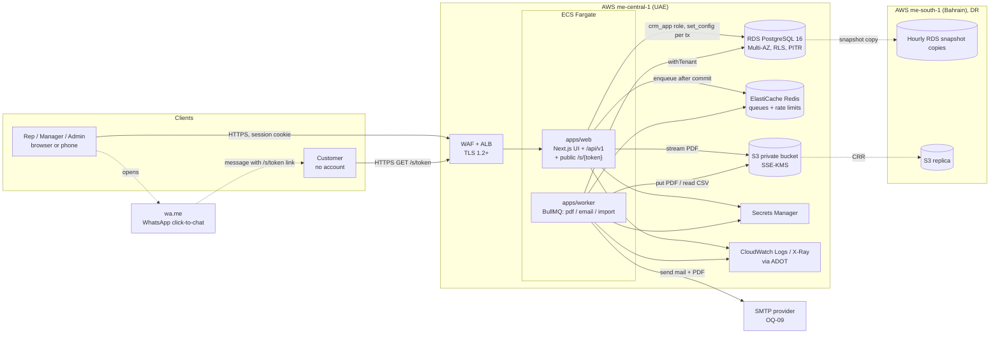

# TRD: Technical Design

Status: **Draft for review** (2026-10-27)
Requirements: `docs/PRD.md` · Schema: `docs/SCHEMA.md` · API: `docs/openapi.yaml` · Threats: `docs/THREAT_MODEL.md` · Decisions: `docs/adr/`

This document says *how* the PRD is built. Each section is short and links to the ADR that holds the reasoning and the alternatives considered.

## Stack

Versions were checked with `npm view` on 2026-10-27, and APIs were checked in Context7. Exact versions are pinned in the lockfile at slice 1.

| Layer | Choice | Version line | ADR |
|---|---|---|---|
| Language | TypeScript (strict) | **5.9.3** (fallback taken 2026-10-27: typescript-eslint lacks TS 7 support; see ADR-0001). Target 7.0.x once supported | [0001](adr/0001-modular-monolith-nextjs-pnpm.md) |
| Monorepo | pnpm workspaces | pnpm 12.x | [0001](adr/0001-modular-monolith-nextjs-pnpm.md) |
| Web + API | Next.js App Router (React) | next 16.4.x, react 19.3.x | [0001](adr/0001-modular-monolith-nextjs-pnpm.md) |
| Validation | Zod (shared client and server) | 4.6.x | [0015](adr/0015-rest-api-zoho-shape-openapi.md) |
| Phone numbers | libphonenumber-js (E.164 normalisation, US-06) | 1.13.x | — |
| Database | PostgreSQL | 16 | [0002](adr/0002-postgresql-16-drizzle.md) |
| ORM and migrations | Drizzle ORM, drizzle-kit | 0.45.x / 0.31.x (stable, not v1 beta) | [0002](adr/0002-postgresql-16-drizzle.md) |
| Auth | Better Auth (email/password, `organization`, `admin` plugins) | 1.7.x | [0004](adr/0004-auth-better-auth.md) |
| Jobs | Redis + BullMQ (ioredis) | bullmq 6.4.x, ioredis 6.0.x, Redis 7 | [0011](adr/0011-jobs-redis-bullmq.md) |
| Files | S3-compatible (`@aws-sdk/client-s3` v3), MinIO in dev | 3.x | [0012](adr/0012-file-storage-s3.md) |
| Money | decimal.js (ROUND_HALF_UP) + Postgres `numeric` | 10.6.x | [0007](adr/0007-money-vat-currency.md) |
| PDF | Headless Chromium (puppeteer-core) in the worker | pinned with the worker image | [0010](adr/0010-pdf-rendering-headless-chromium.md) |
| i18n | next-intl | 4.14.x | [0016](adr/0016-i18n-rtl-mobile-first.md) |
| Observability | pino, OpenTelemetry → CloudWatch / X-Ray (in-region) | pino 10.x | [0014](adr/0014-observability.md) |
| Tests | Vitest (unit and integration against real PG), Playwright (E2E, 360 px project) | vitest 5.0.x, playwright 1.64.x | — |
| Hosting | AWS `me-central-1` primary, `me-south-1` DR (proposed, pending OQ-03) | — | [0013](adr/0013-hosting-aws-gcc.md) |

## Architecture

A modular monolith with two deployables built from one repo ([ADR-0001](adr/0001-modular-monolith-nextjs-pnpm.md)):

```
apps/web       Next.js: UI (server components) + REST route handlers /api/v1 + public /s/{token}
apps/worker    BullMQ workers: pdf, email, import; outbox sweeper
packages/core  Zod schemas, pricing engine, visibility/permissions, domain services, withTenant()
packages/db    Drizzle schema, SQL migrations (incl. RLS policies, triggers, grants), seed
```

Route handlers and server components both call services in `packages/core`. Services get a DB handle only through `withTenant(ctx, fn)` (see Tenancy).

### System diagram



### Request lifecycle (authenticated API)

1. **Session.** `proxy.ts` (Next 16) runs on `/app` pages only and redirects to `/login` when no session cookie is present. It makes no authorization decisions. API routes answer 401 themselves. Locale needs nothing here while the MVP is English-only.
2. **Handler.** Every `/api/v1` handler is wrapped by `apiRoute` (`apps/web/lib/api.ts`). It resolves the session through Better Auth (`resolveContext`), yielding `user_id`, `org_id`, `role` and `status`. A missing, banned or deactivated session returns 401.
3. **Role permission.** The wrapper checks the route's declared permission against the role matrix (ADR-0005) and returns 403 when the role may not perform the action at all.
4. **Input validation.** The body is capped (413), then validated against the shared Zod schema (query string on GET/DELETE, JSON body otherwise). Failure returns 422 with errors per field. Unknown keys, including any client-sent totals, are stripped. A malformed `{id}` returns 404 and never reaches SQL.
5. **Tenant transaction.** `withTenant({orgId, userId, role, visibleOwnerIds, seeAll}, fn)` opens a transaction and runs `set_config(..., true)` for each value. The service runs inside it, applies the visibility predicate (RLS enforces it too), and calls the pricing engine when money is involved.
6. **Timeline.** A `timeline_events` row is written in the same transaction for every change.
7. **Side effects.** They are queued only after commit (ADR-0011).

## Tenancy and Row Level Security

[ADR-0003](adr/0003-tenancy-org-id-row-level-security.md)

- **Shared schema.** Every tenant table has `org_id NOT NULL`, indexes that lead with `org_id`, `ENABLE` + `FORCE ROW LEVEL SECURITY`, and the `tenant_isolation` policy on `app.org_id()` (the transaction's `app.org_id` setting, NULL when unset).
- **Fail closed.** If the setting is not set, queries return zero rows.
- **DB roles.** `crm_owner` holds DDL and runs migrations. `crm_app` (web and worker) has no `BYPASSRLS`. `crm_auth` serves the Better Auth global tables only.
- **Context bleed.** Settings are transaction-local (`is_local = true`), so pooled connections cannot carry context from one request to the next.
- **No-org paths.** The only paths without an org context are Better Auth's own tables and `resolve_share_link()`, a `SECURITY DEFINER` function with a pinned `search_path`.
- **CI guard.** A test fails if any table with an `org_id` column lacks RLS + FORCE + the policy. All integration tests connect as `crm_app`.

## RBAC and record visibility

[ADR-0005](adr/0005-rbac-and-record-visibility.md)

- **Roles.** `admin`, `manager` and `rep`, defined in the permission matrix with Better Auth `createAccessControl`.
- **Hierarchy.** `member.manager_id` forms the reporting tree. Per request, a recursive CTE yields `visible_owner_ids` (self plus all reports). Admin gets `see_all`.
- **Visibility by module:**

  | Visibility | Modules |
  |---|---|
  | Public in org | Accounts, Contacts, Products |
  | Private | Leads, Deals, Quotes, Sales Orders, Invoices, Activities |

  Private modules get an extra `AS RESTRICTIVE` RLS policy `owner_visibility`. The service layer applies the same predicate.
- **404, never 403, for records you cannot see.** The same filter applies to list, search, related lists, timeline, export, PDF download and share-link creation, and to forecasts when they arrive in Phase 2 (moved out of the MVP on 2026-10-27).
- **Transfer (US-03).** An Admin-only service reassigns open Leads, Deals, Quotes, Sales Orders and Activities in one transaction and writes a timeline row per record.

## Metadata-driven modules

[ADR-0006](adr/0006-metadata-driven-fields-and-layouts.md)

- **Metadata as data.** `modules`, `fields`, `picklists`, `picklist_values`, `layouts`, `layout_sections`, `layout_fields` and `field_permissions` are org-scoped data. Standard fields are seeded per org as `is_system` rows that point at real columns.
- **Storage.** Standard modules use typed columns plus `custom jsonb`. Custom field values live in `custom`, keyed by `api_name`. They are validated by a Zod schema the server builds from metadata, and unknown keys are rejected.
- **UI from metadata.** Form, detail, list and filter UIs render from layouts. Lead convert, deal stages and line items are bespoke code, as forecasts will be in Phase 2 (moved out of the MVP on 2026-10-27).
- **Phase 2.** The admin UI only inserts and updates metadata rows. It needs no DDL, except an optional expression index for a hot custom field, added by migration.
- **Not in MVP.** Custom modules: `modules.is_custom` exists, but there is no generic record store yet.

## Money, VAT and currency

[ADR-0007](adr/0007-money-vat-currency.md)

- **Exact types only.** Amounts are `numeric(18,3)`, rates `numeric(18,8)` and percentages `numeric(7,4)`. They travel as strings end to end, and arithmetic uses decimal.js. JS `number` is never used for money.
- **Currencies.** OMR (scale 3, base), AED and INR (scale 2). Each header stores `currency`, `currency_scale`, `exchange_rate` (OMR per unit) and OMR equivalents.
- **Per line.**
  - `amount = qty × price` → round
  - `discount` (percent or flat) → round
  - `net = amount − discount`
  - `vat = net × rate` for `standard`, else 0 → round half-up to the currency scale
  - `total = net + vat`
  - Each line snapshots `vat_category` + `vat_rate`.
- **Header.**
  - `sub_total = Σ net`, `vat_total = Σ vat`, plus a VAT summary per category.
  - `grand_total = sub_total + vat_total + adjustment`. There is no VAT on the adjustment (OQ-04) and no header discount.
  - The US-10 worked example is a unit test fixture: 358.190 → adjustment −0.190 → 358.000.
- **VAT rate.** Stored in `vat_rates` (category, rate, effective_from). New documents take the effective rate, and existing documents keep their snapshot.
- **Exchange rates.**
  - Each rate in `exchange_rates` (currency, rate, effective_from) is entered by an Admin.
  - Captured on create, and again on currency change while the document is a draft.
  - Copied unchanged through Quote → SO → Invoice.
  - With no effective rate, creation is blocked.
- **OMR product on an AED/INR document.** The price defaults to `omr_price ÷ rate`, rounded to 2 dp, and can be edited.
- **No client totals.** The server never accepts totals: Zod input schemas omit them, and only the pricing engine writes amount columns.

## Tax-invoice numbering and locking

[ADR-0008](adr/0008-gap-free-invoice-numbering-and-locking.md)

- **Drafts have no number.** `issue` locks the invoice row, re-prices it, then takes the next number from `document_sequences` with `UPDATE … RETURNING` inside the same transaction. A rollback leaves no gap. `UNIQUE(org_id, invoice_number)`.
- **Locking.** After issue, triggers block changes to the header money fields and to the lines. The only allowed transitions are `issued → paid | cancelled`, and a cancelled invoice keeps its number.
- **Open questions.** OQ-06 decides the format and starting number; OQ-05 decides whether credit notes are needed.

## PDF share links (WhatsApp)

[ADR-0009](adr/0009-pdf-share-tokens.md), [ADR-0010](adr/0010-pdf-rendering-headless-chromium.md)

- **Token.** A 256-bit random token, base64url. Only its SHA-256 hash is stored, and each token points to one immutable PDF file.
- **Lifetime.** `expires_at` is 7 days by default; links can be revoked.
- **Public route.** `/s/{token}`:
  - Format check, then `resolve_share_link()`, then the PDF is streamed from S3.
  - Unknown, expired and revoked tokens all get the same 404 "link expired" page.
  - Response headers: `no-store`, `noindex`, `no-referrer`, `nosniff`, CSP `default-src 'none'`.
  - Rate-limited per IP (Redis), plus a WAF rule.
  - The token is redacted from logs and traces.
- **WhatsApp action.** `wa.me/<E.164>?text=<message with link>` opens on the client, and the server logs the activity "WhatsApp link shared". The button is disabled when the contact has no mobile number.
- **PDF rendering.** Headless Chromium runs in the worker with network access blocked. An issued invoice's PDF is rendered once and stored immutably. Chromium was chosen so Arabic (OQ-02) works later.

## Email sending

US-13: Send Email creates an `email_sends` row (`queued`) and enqueues `email:<id>` after commit. The worker attaches the PDF and sends it over the org's SMTP settings (credentials live in Secrets Manager, and the DB holds only a reference). On success, the same transaction sets `sent` and writes the activity "Email sent to X". A failure marks the row `failed`, the UI shows the error, and no "sent" activity is written.

## i18n, RTL and mobile

[ADR-0016](adr/0016-i18n-rtl-mobile-first.md)

- **Strings.** All strings come from next-intl messages (English only for the MVP). Metadata labels are message keys.
- **Lint.** `pnpm check` fails on literal JSX strings and on physical CSS or Tailwind direction utilities. `dir` is set from the locale.
- **Mobile.** Layouts are built mobile-first at 360 px.
- **E2E.** Playwright runs a `mobile-360` project covering US-05, US-07, US-10, US-13 and US-14, and asserts there is no horizontal scroll.

## Job queue, file storage, observability

- **Jobs** ([ADR-0011](adr/0011-jobs-redis-bullmq.md)):
  - Queues `pdf`, `email` and `import` run on BullMQ.
  - Payloads carry ids only and are Zod-validated, and the worker runs every job under `withTenant`.
  - Jobs are enqueued after commit. A pending-row sweeper acts as a light outbox.
  - Job ids are derived from the intent (`email:<email_sends.id>`), so a redelivered job is a no-op.
  - Failed jobs go to a dead-letter queue, which raises an alert.
- **Files** ([ADR-0012](adr/0012-file-storage-s3.md)):
  - One private S3 bucket, SSE-KMS encrypted, with keys `org/<org_id>/<kind>/<uuid>`.
  - The `files` table is the source of truth.
  - Downloads stream through the app. We never issue presigned URLs to customers.
  - CSV uploads are capped at 20 MB, and their content is sniffed.
- **Observability** ([ADR-0014](adr/0014-observability.md)):
  - pino JSON logs with PII and token redaction.
  - OpenTelemetry traces and metrics go to CloudWatch and X-Ray in-region.
  - SLO alerts cover p95, uptime, 5xx rate, the DLQ and backups.
  - No third-party SaaS receives PII.
  - Security-relevant events are stored durably in `timeline_events`.

## Non-functional requirements → mechanism

| NFR (PRD G5/E11) | Target | Mechanism | Verified by |
|---|---|---|---|
| Speed | p95 < 1 s on list/detail APIs at 100k records per tenant | Indexes that lead with `org_id` on every list sort and filter path, keyset-friendly `(org_id, owner_id, updated_at)` indexes, `per_page ≤ 200`, no N+1 (related lists loaded in batch), PDFs rendered off the request path | k6 or autocannon load test against a seeded tenant with 100k records (in CI on staging), plus the CloudWatch p95 alarm |
| Uptime | 99.5% in business hours (Sun–Thu, hours per OQ-08) | ≥ 2 web tasks across 2 AZs, RDS Multi-AZ, ElastiCache replica, health checks, rolling deploys | Synthetic check every minute, plus a monthly SLO report |
| RPO | 1 h | RDS PITR (≈ 5 min) plus **hourly** snapshots copied to `me-south-1`; S3 cross-region replication | Backup-failure alarm, plus the restore drill |
| RTO | 4 h | Runbook to restore into `me-south-1` from snapshot and S3 replica; infrastructure as code for the stack | Drill before go-live and every quarter (PRD M5), recorded in `docs/RUNBOOK.md` |
| Capacity | 50 tenants × 50 users × 100k records | One RDS instance (vertical scaling first), stateless web (horizontal scaling), RLS predicates served by indexes | Load test at 100k records |
| Phone | 360 px | Mobile-first CSS, Playwright `mobile-360` project | E2E |
| i18n | No hard-coded strings, RTL-safe | next-intl, lint rules | `pnpm check` |
| Residency | GCC region | AWS `me-central-1` / `me-south-1`; in-region telemetry | ADR-0013 (pending OQ-03) |

## Hosting

[ADR-0013](adr/0013-hosting-aws-gcc.md), status **Proposed** until OQ-03 is answered.

- **Primary region (`me-central-1`).** ECS Fargate, RDS PostgreSQL 16 Multi-AZ, ElastiCache Redis, S3, Secrets Manager, ALB + WAF, CloudWatch.
- **DR region (`me-south-1`).** Snapshot copies and the S3 replica.
- **Fallback.** If OQ-03 requires Oman residency, the same containers, Postgres, Redis and S3-compatible storage move to an Oman provider. The app uses no AWS-only APIs.

## Environments

| Env | Purpose | Infra | Data | Auth |
|---|---|---|---|---|
| **dev** | Local development | `docker compose`: postgres:16, redis:7, MinIO, Mailpit (catches SMTP) | `pnpm db:seed`: orgs *Saqient* and *Demo*, seeded users per role | Real Better Auth sign-in with seeded users. **No bypass.** |
| **test** | CI (unit, integration, E2E) | Ephemeral Postgres and Redis containers per run. Migrations run as `crm_owner`, tests connect as `crm_app` | Seed plus per-test fixtures | Seeded users |
| **staging** | Pre-prod verification, load tests, restore drills | Same IaC as prod, smaller instances, separate AWS account | Synthetic data only, including the 100k-record tenant. Never prod copies containing PII | Seeded users plus invited testers |
| **prod** | Live | AWS `me-central-1` + DR `me-south-1`, separate account | Real | Real users only. Seed users are not created |

**Config.** All config comes from typed, Zod-validated environment variables. A failed parse stops the app at boot. Secrets come from Secrets Manager (prod and staging) or `.env.local`, which is gitignored (dev). `.env.example` is committed with placeholders.

## TEMP-DEV flags

CLAUDE.md rule: any dev-only relaxation must be a **typed config flag**, marked in code with `// TEMP-DEV: <id>`, and listed in the table in [`docs/PRODUCTION_READINESS.md`](PRODUCTION_READINESS.md#temp-dev-flags) (ID, flag, why, remove-by).

- **No flags exist yet.** The table is empty, and this design adds none.
- **Not relaxations.** Dev using MinIO, Mailpit, and local Postgres and Redis is environment configuration, not a relaxation. Those environments run the same auth, RLS and validation as prod.
- **Never allowed.** No auth bypass, magic header, or "skip auth in dev" code path is permitted under any flag.
- **Enforcement.** CI greps for `TEMP-DEV:` markers and fails if any ID is missing from the table, or if any flag is enabled in the prod config schema.

## PRD coverage

| Story | Main API (`openapi.yaml`) | Main tables (`SCHEMA.md`) |
|---|---|---|
| US-01 sign-in, org isolation | Better Auth routes, every `/api/v1` path returns 404 cross-org | `orgs`, `user`, `member`, RLS on all |
| US-02 private/public visibility | All module GETs and search | `owner_visibility` policies |
| US-03 users, deactivate, transfer | `/users`, `/users/{id}/actions/deactivate`, `/users/{id}/actions/transfer` | `member`, `user`, `timeline_events` |
| US-04 capture lead | `POST /Leads` | `leads` |
| US-05 convert lead | `GET /Leads/{id}/__conversion_options`, `POST /Leads/{id}/actions/convert` | `leads`, `accounts`, `contacts`, `deals`, `activities` |
| US-06 accounts/contacts | `/Accounts`, `/Contacts`, related lists | `accounts`, `contacts` |
| US-07 deal stages | `PUT /Deals/{id}`, `GET /settings/pipeline` | `deals`, `pipelines`, `stages`, `deal_stage_history` |
| US-08 products + VAT | `/Products`, `/settings/vat_rates` | `products`, `vat_rates` |
| US-09 exchange rates | `/settings/currencies`, `/settings/exchange_rates` | `currencies`, `exchange_rates` |
| US-10 quote pricing | `/Quotes` | `quotes`, `quote_lines` |
| US-11 conversions | `POST /Quotes/{id}/actions/convert`, `POST /Sales_Orders/{id}/actions/convert` | `sales_orders`, `invoices` (+ lines) |
| US-12 tax invoice | `POST /Invoices/{id}/actions/issue`, `…/cancel`, `…/mark_paid`, `GET /{Module}/{id}/pdf` | `invoices`, `invoice_lines`, `document_sequences`, `files` |
| US-13 email | `POST /{Module}/{id}/actions/send_email` | `email_sends`, `activities` |
| US-14 WhatsApp | `POST /{Module}/{id}/share_links`, `DELETE …/{link_id}`, `GET /s/{token}` | `share_links`, `files`, `activities` |
| US-15 activities + timeline | `/Tasks`, `/Calls`, `/Meetings`, `GET /{Module}/{id}/timeline` | `activities`, `timeline_events` |
| US-16 forecasts: **Phase 2**, not built in the MVP (scope change 2026-10-27) | `GET /forecasts`, `PUT /forecasts/targets` (`x-phase: 2`) | `forecast_targets` (Phase 2), `deals` |
| US-17 Zoho import | `/imports` (upload, dry run, confirm, errors CSV) | `import_jobs`, `import_rows`, `zoho_id` columns |

## Key decisions (see adr/)

| ADR | Decision | Status |
|---|---|---|
| [0001](adr/0001-modular-monolith-nextjs-pnpm.md) | Modular monolith: Next.js App Router + worker, pnpm workspaces, TS 7 with 5.9 fallback | Accepted |
| [0002](adr/0002-postgresql-16-drizzle.md) | PostgreSQL 16 + Drizzle (stable line), reviewed SQL migrations | Accepted |
| [0003](adr/0003-tenancy-org-id-row-level-security.md) | Shared schema, `org_id` + FORCE RLS, transaction-local context | Accepted |
| [0004](adr/0004-auth-better-auth.md) | Better Auth: email/password, organization + admin plugins | Accepted |
| [0005](adr/0005-rbac-and-record-visibility.md) | 3 roles + manager hierarchy; restrictive RLS for private modules; 404 not 403 | Accepted |
| [0006](adr/0006-metadata-driven-fields-and-layouts.md) | Metadata tables + typed core columns + `custom jsonb` | Accepted |
| [0007](adr/0007-money-vat-currency.md) | `numeric` + decimal.js, per-line half-up VAT, rate snapshot | Accepted (OQ-04) |
| [0008](adr/0008-gap-free-invoice-numbering-and-locking.md) | Counter row in issuing transaction; lock triggers | Accepted (OQ-05, OQ-06) |
| [0009](adr/0009-pdf-share-tokens.md) | Hashed 256-bit tokens, 7-day expiry, revocable, one file | Accepted |
| [0010](adr/0010-pdf-rendering-headless-chromium.md) | Headless Chromium in worker, network-isolated | Accepted |
| [0011](adr/0011-jobs-redis-bullmq.md) | BullMQ, enqueue after commit, intent-derived job ids | Accepted |
| [0012](adr/0012-file-storage-s3.md) | Private S3, SSE-KMS, stream through app | Accepted |
| [0013](adr/0013-hosting-aws-gcc.md) | AWS `me-central-1` + DR `me-south-1` | **Proposed** (OQ-03) |
| [0014](adr/0014-observability.md) | pino + OTel → CloudWatch/X-Ray in-region | Accepted |
| [0015](adr/0015-rest-api-zoho-shape-openapi.md) | REST `/api/v1` mirroring Zoho v8, OpenAPI 3.1, Idempotency-Key | Accepted |
| [0016](adr/0016-i18n-rtl-mobile-first.md) | next-intl, logical CSS lint, 360 px Playwright project | Accepted |
| [0017](adr/0017-user-admin-in-crm-services.md) | Invite-only sign-in; invite and deactivate in CRM services, not Better Auth's plugin endpoints; per-IP + per-account sign-in limits | Accepted |
